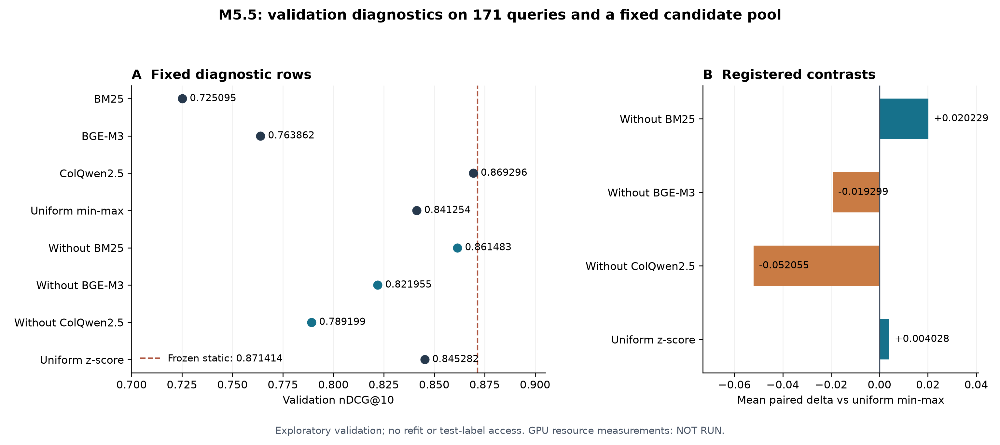

# M5.5 — Báo cáo chẩn đoán CPU của Khương

Ngày: 27/10/2026. Owner: Khương. Nhánh: `feature/m5-5-diagnostics`.

**Kết luận:** R5-01/02/03 đã chạy trên dữ liệu thật và được kiểm chứng kỹ thuật.
R5-04 latency/CUDA memory là `NOT_RUN_DEFERRED_MODAL_NETWORK_BLOCKED` theo yêu cầu của người dùng.
**M5.5 hiện PARTIAL, chưa nghiệm thu toàn bộ; review độc lập của thành viên còn PENDING.**

Lượt tiếp tục PR #45 trên Windows có [hồ sơ hiện hành](../docs/reports/milestones/M5.5/README.md),
bao gồm spec/plan và bằng chứng mới. Các số liệu và receipt CPU bên dưới giữ nguyên.

## Kết quả trên 171 query validation

Cả tám hàng dùng đúng 82.255 candidate rows của M4.2/M3.1, cùng qrels và
page evaluator. Không fit lại trọng số, không train, không chạy retriever,
không đổi QPAF-v1 và không mở test qrels.

| Phương pháp | nDCG@10 | Recall@1 | Recall@3 | MRR@10 |
| --- | ---: | ---: | ---: | ---: |
| BM25 | 0.725095 | 0.549708 | 0.736842 | 0.665314 |
| BGE-M3 | 0.763862 | 0.584795 | 0.795322 | 0.705518 |
| ColQwen2.5 | 0.869296 | 0.736842 | 0.912281 | 0.830472 |
| Uniform CombSUM min–max | 0.841254 | 0.695906 | 0.894737 | 0.797034 |
| Bỏ BM25 (0 / 0.5 / 0.5) | 0.861483 | 0.725146 | 0.894737 | 0.820215 |
| Bỏ BGE-M3 (0.5 / 0 / 0.5) | 0.821955 | 0.666667 | 0.865497 | 0.773503 |
| Bỏ ColQwen (0.5 / 0.5 / 0) | 0.789199 | 0.619883 | 0.830409 | 0.732827 |
| Uniform CombSUM z-score | 0.845282 | 0.695906 | 0.888889 | 0.800664 |

Các phép bỏ kênh dùng saved min–max, giữ nguyên mọi trang ứng viên và đặt
hai trọng số còn lại bằng 0.5. Z-score chỉ áp dụng cho uniform CombSUM trên
raw scores của từng query/kênh, population std `ddof=0`, giữ điểm âm;
kênh phương sai 0 cho điểm 0. Dữ liệu thật không có kênh hằng ở query nào.

| Đối chiếu với uniform min–max | Mean ΔnDCG@10 | Win / Tie / Loss |
| --- | ---: | ---: |
| Bỏ BM25 (0 / 0.5 / 0.5) | +0.020229 | 24 / 135 / 12 |
| Bỏ BGE-M3 (0.5 / 0 / 0.5) | -0.019299 | 13 / 134 / 24 |
| Bỏ ColQwen (0.5 / 0.5 / 0) | -0.052055 | 3 / 129 / 39 |
| Uniform CombSUM z-score | +0.004028 | 11 / 155 / 5 |

Win/Tie/Loss được ghép theo cùng query, tolerance `1e-12`. Đây là thống kê
mô tả validation, không phải phép thử xác nhận; không có CI hay p-value mới
được suy ra từ bảng này.

## Ý nghĩa

1. **Trong uniform CombSUM đang xét, bỏ điểm BM25 giúp tăng +0.020229 nDCG.**
   Có 24 query tăng, 12 giảm và 135 không đổi. Kết quả chỉ nói về đóng góp
   điểm BM25 với trọng số đều trong candidate pool đã khóa; không kết luận
   có thể bỏ BM25 khỏi candidate generation, vì các trang của nó vẫn ở pool.
2. **Bỏ visual gây giảm lớn nhất: −0.052055.** Bỏ BGE-M3 cũng giảm −0.019299.
   Điều này cho thấy vai trò của visual và dense trong phép trộn cố định này;
   không biến các phép bỏ kênh thành một mô hình mới đã được xác nhận.
3. **Z-score cải thiện nhỏ hơn: +0.004028**, với 11 tăng / 155 hòa / 5 giảm.
   Thay đổi scale chưa đủ làm uniform fusion vượt hệ thống mạnh nhất.
4. Hàng tốt nhất trong tám chẩn đoán là ColQwen2.5 `0.869296`.
   Baseline đã freeze `train_fitted_static` vẫn là **0.871414**,
   với `[BM25=0, BGE=0.1, visual=0.9]` chọn trên train ở M4.2.
   Không có hàng M5.5 nào vượt nó trên validation này. M5.5 không đổi baseline
   mạnh nhất và không chọn lại method/checkpoint theo các số vừa thấy.

Quan sát phù hợp với việc ưu tiên visual và chỉ bổ sung một phần dense trong
static fusion, nhưng không chứng minh một gate học được sẽ vượt baseline.
Nếu nghiên cứu tiếp loss/gate, phải thiết kế phiên bản thí nghiệm riêng; không
sửa QPAF-v1 đã freeze hoặc dùng TEST-172 để chọn phương án.

## Nguồn nghiên cứu và quyết định triển khai

[Nghiên cứu nguồn](../docs/03_method/m5.5-diagnostic-research.md) đối chiếu
COLING 2025 về fusion trong miền/ngôn ngữ chuyên biệt, tài liệu chuẩn hóa
OpenSearch và hướng dẫn CUDA của PyTorch. Kết quả ở dataset khác không được
coi là bằng chứng QPAF tốt hơn trên ViDoSeek.

Chi tiết quan trọng: z-score của OpenSearch có quy tắc sample std/clipping
riêng. Implementation M5.5 tuân thủ đúng M5.1 population std và không clip
điểm âm; không thay protocol theo thư viện/product tham khảo.

## Bằng chứng và tái lập

- Run: [`RUN-QPAF-M5_5-ABL-001-20261027T033016Z-A01`](../results/m5.5/RUN-QPAF-M5_5-ABL-001-20261027T033016Z-A01/report.md).
- Implementation commit: `60a2cc1ffff7c10dccc21602f112ab22040a0384`.
- Execution HEAD: `43ca69c` (commit authorization, source không đổi).
- [Authorization](../evidence/revisions/m5.5-001/authorization.json), SHA-256
  `92d91854949f0e0914e5c3d2e837f811ccfac6eaf485e3ad29e60b5c97f2e0f1`.
- [Run manifest](../results/m5.5/RUN-QPAF-M5_5-ABL-001-20261027T033016Z-A01/manifest.json), SHA-256
  `f141871d5adbd90c11fad5084d6c08a599009e3bd0bbbe5f60513e8eebff03be`.
- [Biên nhận replay](../results/m5.5/verification/technical_verification.json):
  PASS; 13 file của run không đổi; audit hook ghi 0 write, 0 network attempt,
  0 forbidden Modal/CUDA import và 0 lần thử mở test qrels trong lượt replay.
- Bốn hàng tham chiếu BM25/BGE/ColQwen/uniform được tái tính trên 684 cặp
  query–method và khớp M4.4 với sai khác tối đa
  `6.66e-16`, dưới tolerance `1e-12`.
  Saved min–max so raw min–max lệch tối đa 0.0.
- [Software checks](../results/m5.5/verification/software_checks.json):
  **635 tests OK, 3 skipped**, gồm 25 test M5.5; giữ raw log và hash.
- Gói input tải từ GitHub draft release M4.2, archive SHA-256
  `45e764f6bfe081063ea2488dbf5e26ffcaacf2e6f43ea3ad47f56a10c331d2d8`,
  CRC/hash đúng. Chỉ phục hồi bảy payload local còn thiếu; file cũ không ghi đè.

Authorization ghi nguyên văn yêu cầu CPU-only của Khương trong phiên này.
Không gán chữ ký Research Lead hoặc nghiệm thu độc lập cho người chưa xác nhận.
Một reviewer kỹ thuật đã rà source trước run; issue về pin cấu hình M4.4 được
sửa bằng test RED→GREEN và full suite. Đây chưa phải QA acceptance của Thanh.

## Việc để lại cho máy có mạng tới Modal

Xem [bàn giao chi tiết](../docs/06_handover/m5.5-cpu-results-and-gpu-handoff.md).
R5-04 cần benchmark inference gate/fusion của checkpoint frozen, **không train
lại và không extraction retriever**. Không có latency/memory mới hoặc chi phí
GPU phát sinh trong đợt này; số đo mới được để `null`/NOT_RUN.

Metric policy yêu cầu 20 warm-up và >=1.000 label-free measured queries;
M3.6 từng cụ thể hóa thành >=1.000 ID khác nhau. M5.5 chỉ có 171 ID validation.
Trước một run GPU mới, cần review rõ cách đếm các lượt lặp, hoặc phạm vi input
không nhãn khác nếu muốn giữ thiết kế M3.6. Không gọi số lượt lặp là số ID duy
nhất; không kế thừa authorization M3.6. Số M3.6 chỉ là tham chiếu lịch sử.

Sau khi R5-04 được xử lý và review độc lập hoàn tất, mới có cơ sở nghiệm thu
trọn M5.5. R7/TEST-172 và M5.7 vẫn theo protocol ba seed đã khóa.
